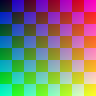

# ZBrush Explorer Thumbnails

See the model preview inside a `.ztl` or `.zpr` file directly in Windows File Explorer.

[한국어 그림 설치 안내 — 처음 사용하는 분은 여기부터](docs/README.ko.md#처음-설치하는-분은-여기부터) · [Testing and compatibility](docs/TESTING.md) · [MIT license](LICENSE)

The provider reads the small preview already embedded in a supported ZBrush file. It does not open ZBrush, render the model, capture your screen, or create an image beside each model file.

**Public version 0.2.0 is model-only.** It contains no ZBrush logo, type-letter badge, vendor model, or proprietary artwork. Images of a separately customized build are not examples of this release. Windows may add its own overlays; this project does not promise or control them.

## Before installing

- Use **64-bit Windows**. Other architectures are not supported by this package.
- Keep both extracted package files together: `ZBrushThumbnailInstaller.exe` and `ZBrushThumbnailProvider.dll`.
- Run the installer as your normal Windows user, **not as administrator**.
- An existing thumbnail handler is preserved: the installer refuses a conflict instead of replacing it. An older custom installation must be removed using its own manager first.

An earlier prototype was tested on Windows x64 with ZBrush **2023.2.2**, including actual ZTL Save As and ZPR Save operations on disposable samples. **The public 0.2.0 package has a new provider identity and portable installer; that exact package has not yet been deployed and verified end to end in Explorer.** Do not treat the earlier test as proof for every release or ZBrush version.

## Install

1. Download the Windows x64 ZIP from [Releases](https://github.com/gimhyuna0221-art/zbrush-explorer-thumbnails/releases) and extract it to a local folder. Do not run the installer from inside the ZIP.
2. Open `ZBrushThumbnailInstaller.exe`. Opening the window only inspects the current state.
3. Select **Install thumbnails** and check the displayed result. An installation is complete only when the manager reports it as installed.
4. Open a folder containing supported ZTL/ZPR files and choose **Large icons** or **Extra large icons** in Explorer. Thumbnail display must be enabled in your Windows settings.

The manager copies its immutable files to:

```text
%LOCALAPPDATA%\ZBrushModelThumbnails\0.2.0\
```

It registers the thumbnail provider for the current user. It leaves the default application, open commands, `DefaultIcon`, and `UserChoice` settings alone. You can close the manager after installation; it is not a background watcher or a startup service.

## Remove or reinstall

Open the installed manager:

```text
%LOCALAPPDATA%\ZBrushModelThumbnails\0.2.0\ZBrushThumbnailInstaller.exe
```

- **Check status** checks the current state.
- **Remove thumbnails** removes this installation's unchanged, owned registration. It keeps the manager, DLL, and recovery journals.
- **Install thumbnails** can enable it again after a completed removal, creating a new retained journal. Repeating Install while the same verified installation is active does not create another installation.

Do not delete the journals to reset an error, overwrite an installed DLL, or remove another program's handler manually. A conflict or interrupted operation is reported for inspection rather than repaired by guessing ownership. Different releases are not an automatic in-place upgrade.

## What to expect

Saving can update the preview when ZBrush writes a new embedded image and Explorer requests it again. This project does not hook ZBrush's save buttons. It cannot manufacture a new viewpoint if the saved preview is blank, old, or missing.

The observed previews were **96 × 96 pixels**. Large Explorer icons cannot reveal detail that is absent from that source image. Windows can retain old thumbnails after a provider change; installation success and immediate repaint of every cached file are separate results. This package does not delete the global thumbnail cache or restart Explorer.

Compatibility is based on observed ZTL/ZPR layouts, not an official format specification. Unknown or malformed data is rejected. Reads are capped at **1 MiB**, dimensions at **512 pixels per side**, and the provider does not write to the supplied model stream. Extracting a valid preview does **not** establish that the complete model is undamaged or recoverable.

QuickSave/AutoSave, recovery behavior, every file-format version, all move/rename/cache cases, and reboot persistence have not been verified. There is no guarantee of immediate refresh for every save.

## Synthetic test preview



This 96 × 96 chart is generated by `tests/GenerateDemo.py` and matches the synthetic stream fixture used by the provider tests. It is **not** a ZBrush model, an Explorer screenshot, or proof of a deployed release. No vendor artwork is used.

## Build from source

The code targets C++17 and is developed with **Visual Studio 2022 Build Tools, MSVC v143, and the Windows SDK**. The scripts locate that toolchain; they do not install it or change security settings.

From the repository root, build the complete package:

```powershell
powershell -NoProfile -File scripts\Build-Package.ps1
```

This builds the provider, records its actual SHA256 in the package contract, then builds the installer and curated ZIP. The expected output is `dist/ZBrush-Explorer-Thumbnails-0.2.0-win-x64.zip`. A custom rebuild that changes installed payload bytes needs a new version directory; do not replace a deployed 0.2.0 binary in place.

See [testing notes](docs/TESTING.md) for synthetic checks and the distinction between a build, direct provider tests, and actual Explorer deployment. Build scripts do not install the extension. Do not rebuild or replace a DLL at a path that is currently registered.

## Help and bug reports

If a file still shows its normal application icon, check the manager's status, Explorer's thumbnail display setting, and whether the file contains a supported embedded preview. A conflicting provider, unsupported file, or stale cache may produce different symptoms; report the exact result rather than changing registry/security settings.

Open an [issue](https://github.com/gimhyuna0221-art/zbrush-explorer-thumbnails/issues) with the package version, Windows build/architecture, ZBrush version, file extension, and the manager's error text. Redact account names and private paths. **Do not upload private models, recovery files, full journals, or screenshots containing private work.** A small self-created synthetic reproduction is preferable when possible.

## License and attribution

Project code is available under the [MIT license](LICENSE). Decoder research was informed by Jens Ch. Restemeier's MIT-licensed `zbrformat`; its attribution and license are included in [THIRD_PARTY_NOTICES.txt](THIRD_PARTY_NOTICES.txt). No vendor artwork or model assets are bundled.

This is an independent community project, not an official ZBrush product.

