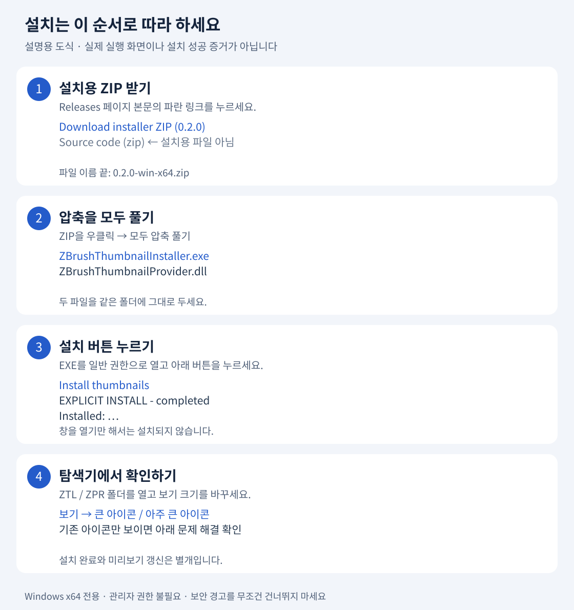

# ZBrush Explorer Thumbnails 사용법

ZTL·ZPR 파일 안에 저장된 모델 미리보기를 Windows 탐색기에 표시합니다.

[English](../README.md) · [시험·호환성](TESTING.md) · [MIT 라이선스](../LICENSE)

ZBrush를 실행하거나 모델 전체를 렌더링하지 않고, 파일 앞부분의 내장 이미지를 읽습니다. 화면을 캡처하거나 모델 파일 옆에 PNG를 만들지 않습니다.

**공개 0.2.0 버전은 모델 이미지만 표시합니다.** ZBrush 로고, ZTL/ZPR 글자 배지, 제작사 모델·이미지는 포함하지 않습니다. 별도로 꾸민 개인용 빌드의 화면을 이 공개 버전의 동작으로 보지 마세요. Windows 자체의 추가 표시는 이 프로그램이 보장하거나 제어하지 않습니다.

## 설치 전 확인

- **64비트 Windows**용입니다. 다른 아키텍처는 지원 대상으로 검증하지 않았습니다.
- 압축을 풀고 `ZBrushThumbnailInstaller.exe`와 `ZBrushThumbnailProvider.dll`을 같은 폴더에 두세요.
- 관리자 권한으로 실행하지 말고 평소 사용자 권한으로 여세요.
- 다른 썸네일 처리기가 있으면 덮어쓰지 않고 설치를 중단합니다. 이전 개인용 버전이 있다면 그 버전의 관리자로 먼저 제거해야 합니다.

이전 프로토타입은 Windows x64·ZBrush **2023.2.2**에서 별도 시험 파일의 ZTL Save As와 ZPR Save 후 갱신을 확인했습니다. **공개 0.2.0은 새 공급자 ID와 이식 가능한 설치기를 사용하며, 이 정확한 공개 패키지를 설치한 탐색기 통합 시험은 아직 하지 않았습니다.** 이전 결과가 모든 버전의 호환성을 뜻하지는 않습니다.

## 처음 설치하는 분은 여기부터

**[① 설치용 ZIP 바로 받기 (Windows x64 · 0.2.0)](https://github.com/gimhyuna0221-art/zbrush-explorer-thumbnails/raw/refs/tags/v0.2.0/downloads/v0.2.0/ZBrush-Explorer-Thumbnails-0.2.0-win-x64.zip)**

코딩이나 Visual Studio 설치는 필요 없습니다. 아래 네 단계만 따라 하세요.



> 위 이미지는 버튼과 순서를 쉽게 설명한 **도식**입니다. 실제 Windows 화면 캡처나 이 버전의 설치 성공 증거가 아닙니다. Windows 버전에 따라 메뉴 위치는 다를 수 있습니다.

### 1. 설치용 ZIP을 받으세요

위의 **설치용 ZIP 바로 받기**를 누릅니다. 파일 이름은 `ZBrush-Explorer-Thumbnails-0.2.0-win-x64.zip`입니다.

[릴리스 페이지](https://github.com/gimhyuna0221-art/zbrush-explorer-thumbnails/releases/tag/v0.2.0)에서 받는다면 본문에 있는 **Download installer ZIP (0.2.0)**을 누르세요. 아래쪽 **Source code (zip)** / **Source code (tar.gz)**는 소스 코드 묶음이지 바로 실행할 설치 패키지가 아닙니다.

### 2. ZIP을 우클릭하고 ‘모두 압축 풀기’를 누르세요

압축이 풀린 폴더를 엽니다. 안에 있는 두 파일을 함께 둡니다.

```text
압축을 푼 폴더
├─ ZBrushThumbnailInstaller.exe  ← 이 파일을 더블클릭
└─ ZBrushThumbnailProvider.dll   ← 지우거나 따로 옮기지 않기
```

다른 안내 파일이 함께 있어도 정상입니다. **ZIP 안에서 실행하거나 EXE 하나만 다른 곳으로 옮겨 실행하지 마세요.** ‘관리자 권한으로 실행’은 필요 없습니다.

### 3. ‘Install thumbnails’를 누르고 결과를 확인하세요

`ZBrushThumbnailInstaller.exe`를 더블클릭한 뒤 **Install thumbnails**를 누릅니다. 창을 여는 것만으로는 설치되지 않습니다.

- `EXPLICIT INSTALL - completed`와 `Installed:`로 시작하는 결과가 표시되는지 확인합니다.
- `not completed / refused` 또는 오류가 보이면 설치 완료가 아닙니다. 반복해서 누르거나 레지스트리를 직접 바꾸지 말고, 아래 문제 해결을 확인하세요.
- 설치 완료 후에는 **Close**로 창을 닫아도 됩니다.

> 이 배포 파일은 **디지털 서명되지 않은 실험판**입니다. Windows가 경고하면 무조건 ‘실행’을 누르거나 보안 기능을 끄지 마세요. 다운로드 출처와 [공개 체크섬](https://github.com/gimhyuna0221-art/zbrush-explorer-thumbnails/blob/v0.2.0/downloads/v0.2.0/SHA256SUMS.txt)을 확인하고, 판단하기 어렵다면 멈춘 뒤 경고 문구를 알려 주세요.

### 4. ZTL·ZPR 폴더를 ‘큰 아이콘’으로 보세요

평소 작업 파일이 있는 폴더를 열고 탐색기의 **보기 → 큰 아이콘** 또는 **아주 큰 아이콘**을 선택합니다. 지원하는 내장 미리보기가 있는 파일이면 모델 이미지가 표시될 수 있습니다.

일반 아이콘만 보여도 파일이 손상됐다는 뜻은 아닙니다. 아래 순서로 확인하세요.

| 보이는 상황 | 먼저 할 일 |
| --- | --- |
| 설치됐는지 모르겠어요 | 설치기에서 **Check status**를 누르고 결과를 확인하세요. |
| 설치됐는데 아이콘만 보여요 | 큰 아이콘 보기인지, Windows의 썸네일 표시가 켜져 있는지 확인하세요. 폴더 옵션의 ‘아이콘은 항상 표시하고 미리 보기는 표시하지 않음’ 항목이 켜져 있다면 미리보기가 숨겨집니다. |
| 어떤 파일만 안 보여요 | 해당 파일의 내장 이미지가 없거나 지원하지 않는 형식일 수 있습니다. 원본 모델을 덮어쓰며 시험하지 마세요. |
| 예전 이미지가 보여요 | Windows에 이전 미리보기가 남을 수 있습니다. 이 프로그램은 캐시를 강제로 지우거나 탐색기를 재시작하지 않습니다. |
| 충돌·거부·오류가 나와요 | 다른 처리기를 임의로 지우지 마세요. 개인 경로를 가린 오류 문구를 [Issues](https://github.com/gimhyuna0221-art/zbrush-explorer-thumbnails/issues)에 남겨 주세요. |

설치 위치:

```text
%LOCALAPPDATA%\ZBrushModelThumbnails\0.2.0\
```

현재 사용자에게만 썸네일 연결을 추가합니다. 기본 열기 프로그램, 열기 명령, `DefaultIcon`, `UserChoice`는 바꾸지 않습니다. 설치 후 관리자 창은 닫아도 됩니다. 상시 감시 프로그램이나 시작 서비스는 없습니다.

## 제거·재설치

아래 설치된 관리자를 일반 권한으로 여세요.

```text
%LOCALAPPDATA%\ZBrushModelThumbnails\0.2.0\ZBrushThumbnailInstaller.exe
```

- **Check status**: 현재 상태 확인.
- **Remove thumbnails**: 이 설치가 소유하며 변경되지 않은 연결만 제거. 실행 파일·DLL·복구 기록은 보관.
- **Install thumbnails**: 제거 완료 후 다시 사용. 새 기록을 만들며, 같은 설치가 정상적으로 활성화된 상태에서는 중복 설치하지 않음.

오류를 없애려고 기록을 지우거나, 설치된 DLL을 덮어쓰거나, 다른 프로그램의 연결을 직접 삭제하지 마세요. 충돌·중단 상태는 임의로 복구하지 않고 알려 줍니다. 서로 다른 릴리스 간 자동 덮어쓰기 업데이트는 지원하지 않습니다.

## 동작과 한계

ZBrush가 저장 파일의 내장 이미지를 갱신하고 탐색기가 다시 요청하면 바뀐 이미지를 읽습니다. 저장 버튼을 가로채는 기능은 아닙니다. 내장 이미지가 비었거나 오래됐다면 원하는 새 구도를 만들어 낼 수 없습니다.

확인한 내장 이미지는 **96×96픽셀**입니다. 큰 아이콘에서도 원본에 없는 세부 묘사가 늘어나지 않습니다. 공급자를 바꾼 후에는 Windows 캐시에 이전 이미지가 남을 수 있습니다. 설치 성공과 모든 캐시 이미지의 즉시 갱신은 별개입니다. 전체 썸네일 캐시 삭제나 Explorer 재시작은 하지 않습니다.

공식 형식 명세가 아닌 관찰된 ZTL/ZPR 구조를 지원합니다. 알 수 없거나 손상된 입력은 거부합니다. 읽기는 **최대 1 MiB**, 이미지 한 변은 **최대 512픽셀**로 제한하며 전달받은 모델 스트림에 쓰지 않습니다. 미리보기를 읽었다고 모델 전체가 정상 저장됐거나 복구 가능하다는 뜻은 아닙니다.

QuickSave·AutoSave·복구 동작, 모든 파일 버전, 모든 이동·이름 변경·캐시 상황, 재부팅 후 동작은 검증하지 않았습니다. 모든 저장에서 즉시 갱신된다고 보장하지 않습니다.

## 합성 시험 이미지


`tests/GenerateDemo.py`가 만든 96×96 시험 차트이며 공급자 합성 입력과 대응합니다. **ZBrush 모델이나 탐색기 화면 캡처가 아니며, 공개 버전이 설치됐다는 증거도 아닙니다.** 제작사 이미지는 사용하지 않았습니다.

## 직접 빌드

C++17, **Visual Studio 2022 Build Tools의 MSVC v143와 Windows SDK**를 사용합니다. 스크립트가 도구를 설치하거나 보안 설정을 변경하지는 않습니다.

저장소 루트에서 전체 패키지를 빌드합니다.

```powershell
powershell -NoProfile -File scripts\Build-Package.ps1
```

공급자 빌드 후 실제 SHA256을 패키지 정보에 기록하고 설치기와 ZIP을 만듭니다. 결과는 `dist/ZBrush-Explorer-Thumbnails-0.2.0-win-x64.zip`입니다. 설치된 파일과 다른 바이트를 만드는 직접 수정 빌드는 새 버전 경로를 사용해야 합니다. 배포된 0.2.0을 같은 경로에 덮어쓰지 마세요.

[시험 안내](TESTING.md)에서 합성 입력 시험과 실제 탐색기 설치 시험의 차이를 확인하세요. 빌드는 설치를 실행하지 않습니다. 현재 등록된 경로의 DLL은 다시 빌드하거나 덮어쓰지 마세요.

## 문의·문제 보고

일반 아이콘만 보이면 관리자의 상태, 탐색기 썸네일 설정, 파일의 지원 여부를 확인하세요. 충돌·지원하지 않는 파일·오래된 캐시는 원인이 다를 수 있으므로 레지스트리나 보안 설정을 임의로 바꾸지 말고 표시된 결과를 알려 주세요.

[Issues](https://github.com/gimhyuna0221-art/zbrush-explorer-thumbnails/issues)에 패키지 버전, Windows 빌드·아키텍처, ZBrush 버전, 확장자, 오류 문구를 남겨 주세요. 계정명과 개인 경로는 지워 주세요. **개인 모델·복구 파일·전체 설치 기록·작업 내용이 담긴 화면은 올리지 마세요.** 가능하면 직접 만든 작은 합성 예제로 재현해 주세요.

코드는 [MIT](../LICENSE)로 공개합니다. 디코더 연구에 참고한 Jens Ch. Restemeier의 `zbrformat` 출처와 MIT 고지는 [THIRD_PARTY_NOTICES.txt](../THIRD_PARTY_NOTICES.txt)에 있습니다. 제작사 이미지나 모델은 배포하지 않습니다. 공식 ZBrush 제품과는 별개인 커뮤니티 프로젝트입니다.

